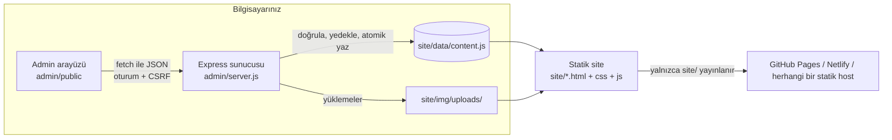

<div align="center">


# Ember: Portfolyo Şablonu

**Sayfayı kaydırdıkça büyüyen bir kamp ateşi olan, iki dilli (TR/EN) sakin bir portfolyo sitesi. İçeriği güncellemek için koda dokunmanızı gerektirmeyen yerel bir admin paneliyle birlikte gelir.**

[](LICENSE)
[](https://nodejs.org)
[](#nasıl-çalışır)
[](#nasıl-çalışır)
[](#nasıl-çalışır)

[English README](README.md) · [Hızlı başlangıç](#hızlı-başlangıç) · [Özelleştirme](#özelleştirme) · [Yayınlama](#yayınlama) · [Belgeler](#belgeler)

</div>

---

## Özellikler

- 🔥 **Kaydırmayla büyüyen kamp ateşi**: sol alt köşedeki canvas ateş, kordan coşkulu bir aleve doğru büyür. Ayarlardan kapatılabilir ve `prefers-reduced-motion` tercihine uyar.
- 📄 **Üst üste binen sayfa geçişleri**: ana sayfa, birbirinin üzerine kayan bölümlerden oluşur; sanki sayfalar açılıyormuş gibi.
- 🌗 **Koyu ve açık tema**: tercih hatırlanır (ya da sistemi izler), tek alanla vurgu rengi değiştirilebilir.
- 🌍 **Türkçe ve İngilizce** hazır, anında dil değiştirme.
- 🧩 **Tüm içerik tek dosyada**: `site/data/content.js` tek doğruluk kaynağıdır (projeler, blog, galeri, biyografi, yetenekler, iletişim, ayarlar).
- 🛠️ **Yerel admin paneli** (Node + Express): her şeyi form arayüzüyle düzenleyin; blok tabanlı blog editörü, sürükleyerek sıralama, görsel yükleme, canlı önizleme, otomatik yedekler.
- ♿ **Erişilebilirlik odaklı**: anlamsal HTML, "içeriğe geç" bağlantısı, klavye ile gezinme, görünür odak, azaltılmış hareket desteği.
- 🚀 **Derleme adımı yok**: düz HTML, CSS ve vanilla JS. `site/index.html` dosyasını açın ya da klasörü herhangi bir yerde yayınlayın.
- 🔒 **Varsayılan olarak güvenli**: admin yalnızca `127.0.0.1` üzerinde dinler; içerik düz metin olarak çizilir (HTML enjeksiyonu yok).

## Ekran görüntüleri

| Koyu | Açık |
|---|---|
|  |  |

**Ateş kaydırmayla büyür** (kor, orta, tam alev):

| Kor | Orta | Tam |
|---|---|---|
|  |  |  |

**Sayfa açılış geçişi** (kaydırma sırasında iki bölüm üst üste biner):


| Projeler | Blog yazısı |
|---|---|
|  |  |

| Galeri | Hakkımda: yetenek çubukları ve halkalar |
|---|---|
|  |  |

**Mobil** (390x844):

<p>
  
  
</p>

**Admin paneli** (yerelde çalışır, yayınlanmaz):

| Kurulum | Özet |
|---|---|
|  |  |

| Proje düzenleme | Blog blok editörü |
|---|---|
|  |  |

| Galeri | Ayarlar |
|---|---|
|  |  |

Canlı önizleme paneli açık, açık admin teması:


> Örnek içerik yer tutucu metin ve üretilmiş SVG görsellerden oluşur. Site adı basitçe "Name"dir. Ekran görüntülerinde admin panelinin arayüzü İngilizce, örnek içerik iki dillidir.

## Hızlı başlangıç

[Node.js](https://nodejs.org) 18 veya üstü gerekir. Node yalnızca admin paneli içindir; site için hiçbir şey gerekmez.

1. **Kodu alın.** GitHub'da **Use this template** düğmesine tıklayın veya klonlayın:

   ```bash
   git clone https://github.com/YOUR-USERNAME/portfolio-site.git
   cd portfolio-site
   ```

2. İki admin bağımlılığını (`express`, `multer`) **kurun**:

   ```bash
   npm install
   ```

3. Admin ve önizleme sunucusunu **başlatın**:

   ```bash
   npm start
   ```

4. <http://localhost:3000/admin/> adresini **açın**. İlk çalıştırmada bir parola belirlersiniz (en az 8 karakter). Sonra içeriğinizi düzenleyip **Kaydet**'e (ya da `Ctrl+S`) basın.
5. Sitenizi <http://localhost:3000/> adresinde ya da admin içindeki Önizleme panelinde **önizleyin**.

**Node yok mu?** Site statiktir. `site/index.html` dosyasına çift tıklayın, `file://` ile çalışır. `site/data/content.js` dosyasını elle de düzenleyebilirsiniz ([şemaya bakın](docs/04-content-schema.md)).

Başka bir port için: `PORT=3100 npm start` (PowerShell: `$env:PORT=3100; npm start`).

## Özelleştirme

### İçeriğiniz (önerilen: admin)

Sitede gördüğünüz her şey `site/data/content.js` dosyasından gelir. Admin paneli bu dosyayı sizin yerinize düzenler, kaydetmeden önce doğrular ve yedek tutar. Admin bölümleri: Özet, Kişisel bilgiler, Hakkımda, Projeler, Blog, Galeri, Ayarlar, Yedekler, Hesap.

### İçerik dosyası biçimi

`content.js`, gövdesi JSON olan tek bir atamadır; sunucu ya da `fetch` olmadan çalışır:

```js
/* content.js: tek dogruluk kaynagi ... */
window.SITE_CONTENT = {
  "site": { "name": { "tr": "Name", "en": "Name" }, "avatar": "img/portrait.svg" },
  "projects": [ { "id": "proj-1", "slug": "first-project",
                  "title": { "tr": "İlk proje", "en": "First project" },
                  "image": "img/proj-1.svg", "status": "done",
                  "featured": true, "order": 1, "visible": true } ],
  "posts": [], "gallery": [],
  "settings": { "defaultLang": "tr", "defaultTheme": "system", "fire": true, "cursor": true }
};
```

Metin alanları `{ "tr": "...", "en": "..." }` çiftleridir; boş bir `en`, `tr` değerine düşer. Blog yazıları HTML değil, tipli bloklardan (`heading`, `paragraph`, `image`, `code`, `quote`, `list`) oluşur. Tüm alan başvurusu ve doğrulama kuralları [docs/04-content-schema.md](docs/04-content-schema.md) dosyasındadır.

Dosyayı istediğiniz an denetleyin:

```bash
npm run validate
```

### Ateş, imleç, tema ve vurgu rengi

**Admin → Ayarlar** içinde (ya da `content.js` içindeki `settings` nesnesinde):

| Ayar | Etki |
|---|---|
| `fire` | `false` kamp ateşi animasyonunu kapatır |
| `cursor` | `false` özel imleci kapatır (zaten yalnızca fare veya kalemle kullanılır) |
| `defaultTheme` | Ziyaretçinin kayıtlı seçimi yoksa `dark`, `light` veya `system` |
| `defaultLang` | Ziyaretçinin kayıtlı seçimi yoksa `tr` veya `en` |
| `accentOverride` | İsteğe bağlı vurgu rengi (`#rgb`, `#rrggbb`, `rgb()`, `hsl()`); temanın üzerine uygulanır |

### Renkler ve tasarım token'ları

Renk, aralık ve hareket değerleri [`site/css/main.css`](site/css/main.css) dosyasının başında CSS özel özellikleri olarak durur: `--bg`, `--fg`, `--accent`, `--accent-hot` ve diğerleri; bir kez koyu tema, bir kez `[data-theme="light"]` için tanımlıdır. Ateşin kendi token'ları [`site/css/fire.css`](site/css/fire.css) içindedir. Tasarım gerekçesi [docs/01-art-direction.md](docs/01-art-direction.md) dosyasındadır.

### Arayüz metinleri ve çeviriler

Menü, düğme ve form hatası metinleri [`site/js/i18n.js`](site/js/i18n.js) içindedir (`window.I18N_DICT`, her dil için bir nesne). Onları orada düzenleyin. Sayfa içeriği `content.js` dosyasından gelir, `i18n.js` içinden asla.

> Üçüncü bir dil eklemek bugün yalnızca içerik değişikliği değildir. [SSS](#sss) bölümüne bakın.

## Nasıl çalışır



- **Site** statiktir. Her sayfa önce `data/content.js` dosyasını yükler, ardından `js/render.js` listeleri, kartları ve blog yazılarını yalnızca `createElement` ve `textContent` kullanarak çizer.
- **Admin**, `127.0.0.1` adresine bağlı bir Express uygulamasıdır. `content.js` dosyasını okur ve yazar, yüklenen görselleri saklar ve önizleme için `site/` klasörünü `/` adresinde de sunar.
- **Yayınlamak**, yalnızca `site/` klasörünü bir statik host'a kopyalamak demektir. `admin/` kendi makinenizde kalır.

### Proje yapısı

```text
.
├── site/                    # web sitesi: yayınladığınız tek şey budur
│   ├── index.html           # ana sayfa: üst üste bölümler (hero, hakkımda, projeler, blog, galeri, iletişim)
│   ├── hakkimda.html        # hakkımda
│   ├── projeler.html        # projeler (etiket filtreleri)
│   ├── blog.html            # blog listesi
│   ├── post.html            # blog yazısı (post.html?slug=...)
│   ├── galeri.html          # lightbox'lı galeri
│   ├── iletisim.html        # iletişim
│   ├── data/content.js      # tüm site içeriği
│   ├── css/                 # main, pages, journey (üst üste binme), fire, cursor
│   ├── js/                  # render, i18n, theme, main, fire (canvas), cursor
│   └── img/                 # yer tutucu görseller; admin yüklemeleri img/uploads/ altına gider
├── admin/                   # yalnızca yerel admin paneli (yayınlanmaz)
│   ├── server.js            # giriş noktası (127.0.0.1'e bağlanır)
│   ├── lib/                 # app, auth, validate, uploads, backups, içerik G/Ç, config
│   ├── public/              # admin ön yüzü (vanilla JS görünümleri)
│   ├── scripts/validate.js  # `npm run validate`
│   └── test/                # node:test paketleri
├── docs/                    # tasarım notları, içerik şeması, ekran görüntüleri
├── .github/                 # CI, Pages yayın iş akışı, issue/PR şablonları
└── package.json
```

Sayfa dosya adları Türkçedir (`hakkimda`, `projeler`, `galeri`, `iletisim`), çünkü şablon Türkçe bir site olarak başladı; görünen etiketler çevrilidir.

## Admin paneli

**Neler yapabilirsiniz**

- Kişisel bilgileri, biyografiyi, yetenekleri (çubuk veya halka), ilgi alanlarını, zaman çizelgesini, SSS'yi ve sosyal bağlantıları düzenleyin.
- Projeleri, yazıları ve galeri öğelerini oluşturun, sıralayın (sürükleyin ya da oklarla), gizleyin ve silin.
- Yazıları blok editörüyle yazın (başlık, paragraf, görsel, kod, alıntı, liste); her metin TR ve EN olarak.
- Görsel yükleyin (20 dosyaya kadar sürükle-bırak, dosya başına 5 MB) ve seçiciden yeniden kullanın.
- Canlı önizleme görün, doğrulamak için **İçeriği denetle**'yi çalıştırın, `Ctrl+S` ile kaydedin.
- **Yedekler**'den önceki bir sürümü geri yükleyin, parolayı değiştirin, panel dilini (TR/EN) ve temayı değiştirin.

**Güvenlik özeti**

| Önlem | Ayrıntı |
|---|---|
| Yalnızca yerel | Yalnızca `127.0.0.1` üzerinde dinler ve başka her `Host` başlığını reddeder (DNS rebinding koruması) |
| Parola | `admin/.auth.json` içinde tuzlu `scrypt` özeti olarak saklanır (düz metin asla); giriş denemeleri sınırlandırılır |
| Oturumlar | `HttpOnly`, `SameSite=Strict` çerez, süresi dolan oturumlar |
| CSRF | Her yazma isteğinde oturum başına token, ayrıca `Origin` ve Fetch-Metadata denetimleri |
| Yüklemeler | Dosya türü uzantıdan değil, görsel imzasından (magic bytes) saptanır; boyut ve adet sınırları, rastgele dosya adları, üzerine yazma yok |
| SVG yüklenemez | SVG betik taşıyabilir, bu yüzden kabul edilmez (pakette gelen yer tutucu görseller şablonla birlikte gelen SVG'lerdir) |
| İçerik güvenliği | Her alanın sunucu tarafı doğrulaması; `javascript:` / `data:` URL'leri reddedilir; site HTML değil metin çizer |
| Yedekler | İçeriği değiştiren her kayıt ve her geri yükleme, önce mevcut `content.js` dosyasını `admin/backups/` içine kopyalar (en yeni 30 tutulur) |
| Atomik yazma | İçerik geçici dosyaya yazılır ve yeniden adlandırılır |

> **Admini asla internete açmayın** (port yönlendirme, tünel ya da barındırma yok). Kendi makineniz için tasarlanmıştır. [SECURITY.md](SECURITY.md) dosyasına bakın.

**Parolayı mı unuttunuz?** Sunucuyu durdurun, `admin/.auth.json` dosyasını silin, yeniden başlatın ve yeni bir parola belirleyin. İçeriğiniz etkilenmez.

## Yayınlama

Yalnızca **`site/`** klasörü yayınlanır. `admin/` klasörünü yayınlamayın; yerel bir araçtır.

Yayınlamadan önce dosyayı bir kez denetleyin: `npm run validate`.

> Varsayılan olarak `.gitignore`, kişisel yüklemeler yanlışlıkla commit'lenmesin diye `site/img/uploads/*` yolunu hariç tutar. Admin üzerinden görsel yükleyip Git'ten yayınlıyorsanız, görsellerin commit'lenip yayınlanması için `.gitignore` içindeki bu iki satırı kaldırın.

### GitHub Pages (dahil iş akışı)

[`.github/workflows/pages.yml`](.github/workflows/pages.yml), elle çalıştırdığında `site/` klasörünü yayınlar (Actions sekmesi → *Deploy site to GitHub Pages* → Run workflow). Önce Pages'i aç (Settings → Pages → Source: GitHub Actions). Her push'ta yayınlamak istersen dosyanın başında anlatılan `push` tetikleyicisini aç.

1. Deponuzu GitHub'a push'layın.
2. **Settings → Pages** içinde **Source** olarak **GitHub Actions** seçin.
3. `main` dalına push'layın (ya da iş akışını **Actions** sekmesinden çalıştırın). Site `https://YOUR-USERNAME.github.io/portfolio-site/` adresinde görünür.

Sitedeki tüm varlık yolları göreli olduğundan, proje alt yolunda da çalışır.

### Netlify, Vercel, Cloudflare Pages, herhangi bir statik host

Her yerde aynı ayarları kullanın:

- **Build command**: yok
- **Publish / output directory**: `site`

Netlify'da `site` klasörünü yayın sayfasına sürükleyip bırakabilirsiniz. Diğer host'larda (S3, nginx, paylaşımlı hosting) `site/` içeriğini yükleyin.

## Performans ve erişilebilirlik

Şablonun yaptığı şeyler, büyük vaatler olmadan:

- Çatı yok, paketleyici yok, site tarafında çalışma zamanı bağımlılığı yok. Betikler `defer` ile yüklenir.
- Görseller `width`/`height` ve `loading="lazy"` ile yazılır; dosyalarınızı önerilen boyutlarda tutun (SSS'ye bakın).
- Ateş canvas'ı çözünürlüğünü sınırlar (cihaz piksel oranı 1,5 ile, mobilde 1,25 ile sınırlı) ve `visibilitychange` olayına yanıt verir.
- Kaydırma animasyonları `IntersectionObserver` kullanır; `prefers-reduced-motion` animasyonları azaltır.
- Anlamsal landmark'lar, içeriğe geç bağlantısı, etiketli kontroller, `aria-live` form hataları ve klavyeyle kullanılabilir menüler.

Pakete dahil örnek içerik üzerinde Lighthouse ile daha önce ölçülen sonuç: **Erişilebilirlik, En İyi Uygulamalar ve SEO için 100**. Performans burada ölçülmedi ve görsellerinize, fontlarınıza ve cihaza bağlıdır; herhangi bir sayıya güvenmeden önce Lighthouse'u kendi içeriğinizde çalıştırın. Fontlar Google Fonts'tan yüklenir; tek dış istek budur.

## Tarayıcı desteği

Chrome, Edge, Firefox ve Safari'nin güncel sürümleri. Site CSS özel özellikleri, `IntersectionObserver`, `<canvas>` ve (vurgu rengi geçersiz kılma için) `color-mix()` kullanır. Otomatik bir çok tarayıcı matrisi çalıştırmadım; önem verdiğiniz bir tarayıcıda bir şey bozulursa lütfen issue açın.

## SSS

**Admin paneli olmadan kullanabilir miyim?**
Evet. `site/` düz statik dosyalardır. `site/data/content.js` dosyasını elle düzenleyin ya da kendi kopyanızda hiç istemiyorsanız `admin/`, `package.json` ve `node_modules` klasörlerini silin. Node'u tutuyorsanız yayınlamadan önce `npm run validate` çalıştırın.

**Gerçekten çok dilli mi?**
İki dil, Türkçe ve İngilizce, bir dil değiştirici ile. Her metin alanı dil başına bir değer tutar. Yalnızca tek bir dile ihtiyacınız varsa `defaultLang` ayarlayın ve o dili doldurun; diğeri aynısını yansıtabilir.

**Yeni bir dil ya da bölüm nasıl eklenir?**
Yeni dil için kod değişikliği gerekir: `site/js/i18n.js` içine bir sözlük ekleyin, `site/js/render.js` içindeki yerelleştirilmiş alan işlemeye yeni anahtarı kabul ettirin, bir dil düğmesi ekleyin ve doğrulayıcıyı ile admin formlarını (`admin/lib/validate.js`, `admin/public/js/`) genişletin. Yeni bir bölüm, HTML'de yeni bir `data-render` bloğu ve `render.js` içinde bir çizici demektir. İkisini de kolaylaştırmak [yol haritasındadır](#yol-haritası).

**Hangi görsel boyutlarını kullanmalıyım?**
Portre 600x800, projeler ve galeri 800x600 (lightbox için 1600 px genişliğe kadar), blog kapağı 1200x675. Her biri için 300 KB altını hedefleyin; yükleme başına katı sınır 5 MB'dır. İzin verilenler: PNG, JPG, WebP, GIF, AVIF.

**Admin parolamı unuttum.**
`admin/.auth.json` dosyasını silip yeniden başlatın; [Admin paneli](#admin-paneli) bölümüne bakın.

**Yedeklerim nerede?**
`admin/backups/` içinde (git tarafından yok sayılır), `content-YYYYMMDD-HHMMSS.js` adıyla. Yedekler sayfasından geri yükleyin ya da birini `site/data/content.js` üzerine kopyalayın.

**Bazı dosya adları neden Türkçe görünüyor?**
Şablon Türkçe bir site olarak başladı. Görünen metin çevrilidir; mevcut bağlantılar bozulmasın diye sayfa dosya adları korunur.

**İletişim formu hiçbir şey göndermiyor.**
Doğru: örnek form yalnızca tarayıcıda doğrular ve bir teşekkür mesajı gösterir. Onu seçeceğiniz bir form servisine ya da arka uca bağlayın.

## Yol haritası

Fikirler, söz değil:

- [ ] Daha fazla dil eklemek için belgelenmiş, daha kolay bir yol
- [ ] İçerik şeması belgesinin İngilizce sürümü
- [ ] Gerçek bir iletişim formu entegrasyon örneği
- [ ] Yüklemede isteğe bağlı görsel yeniden boyutlandırma
- [ ] CI'da ekran görüntüsü ve erişilebilirlik denetimleri

## Katkıda bulunma

Katkılar memnuniyetle karşılanır. Önce [CONTRIBUTING.md](CONTRIBUTING.md) dosyasını (İngilizce) okuyun ve [Davranış Kuralları](CODE_OF_CONDUCT.md)'na uyun. Güvenlik sorunları için [SECURITY.md](SECURITY.md) dosyasına bakın ve herkese açık issue açmayın.

```bash
npm install
npm test            # admin test paketleri (node:test)
npm run validate    # site/data/content.js dosyasını doğrular
```

## Belgeler

[`docs/`](docs/) içindeki dosyalar, projenin planlama aşamasından kalan **tasarım notlarıdır**; kullanım kılavuzu değildir.

| Dosya | Ne olduğu |
|---|---|
| [docs/04-content-schema.md](docs/04-content-schema.md) | Güncel içerik şeması (güncel) |
| [docs/01-art-direction.md](docs/01-art-direction.md) | Görsel yön ve tasarım token'ları (tasarım notları) |
| [docs/02-ux-structure.md](docs/02-ux-structure.md) | Erken UX yapı taslağı (tasarım notları; güncel olmayabilir) |
| [docs/03-backend-content.md](docs/03-backend-content.md) | Erken arka uç planı (tasarım notları; yukarıdaki şema tarafından **geçersiz kılındı**) |

## Lisans

[MIT](LICENSE) © 2026 Portfolio Template Contributors.

## Teşekkürler

- Google Fonts üzerinden [Fraunces](https://fonts.google.com/specimen/Fraunces) ve [Inter](https://fonts.google.com/specimen/Inter) (ikisi de SIL Open Font License altında).
- Admin sunucusu için [Express](https://expressjs.com) ve [Multer](https://github.com/expressjs/multer).
- Davranış kuralları için Contributor Covenant.
